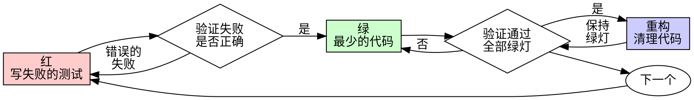

# 测试驱动开发（TDD）

测试应证明用户需要的行为、重要边界和本次修复，避免只重复实现。先识别可观察的验收标准，再选择能发现真实错误的检查。

## 适用范围与职责

- 解释、检查、代码审查默认只读；可以提出测试方案，不据此创建测试或修改生产代码。
- 新增非平凡且可独立测试的逻辑，或修复可复现缺陷时，先建立会因预期问题失败的测试，再实现最小正确修改并验证红→绿。
- 测试先后顺序不是删除已有工作、用户代码或其他代理改动的理由。已有实现缺少测试时，补充行为/回归验证；可在隔离副本对照修复前后，不能在共享工作树破坏代码来造红灯。
- 测试投入按状态、边界、失败影响、可逆性和已有覆盖判断，不按代码行数或文件数。纯展示文字、格式、注释等低影响改动通常无需新增测试；涉及权限、金额、数据或状态时，一行改动也可能需要回归测试。
- 重构优先利用已有行为测试。配置或生成代码选择解析、契约、构建或代表性输出检查，风险高时补相应测试，不一律豁免。
- Ponytail 只指导生产实现，不限制测试数量、框架、夹具或覆盖面。项目编译、序列化资源和验证要求继续生效；测试验收以项目约束与当前用户授权为准。
- 使用项目已有可运行工具。不得为可逆、低影响修改专门引入框架，也不因框架不可用而声称已验证。选择有意义的替代检查并报告缺口。
- Unity/C# 项目保留受影响程序集编译门槛；Editor、Prefab、PlayMode 验证遵循项目授权，未获准运行时给出具体手工步骤。临时测试及提交限制遵循项目规则。

## 红-绿-重构



### 红 - 写失败的测试

写一个最小的测试，展示预期行为。

<Good>
```typescript
test('retries failed operations 3 times', async () => {
  let attempts = 0;
  const operation = () => {
    attempts++;
    if (attempts < 3) throw new Error('fail');
    return 'success';
  };

  const result = await retryOperation(operation);

  expect(result).toBe('success');
  expect(attempts).toBe(3);
});
```
名称清晰，测试真实行为，只测一件事
</Good>

<Bad>
```typescript
test('retry works', async () => {
  const mock = jest.fn()
    .mockRejectedValueOnce(new Error())
    .mockRejectedValueOnce(new Error())
    .mockResolvedValueOnce('success');
  await retryOperation(mock);
  expect(mock).toHaveBeenCalledTimes(3);
});
```
名称模糊，测试的是 mock 而不是代码
</Bad>

**要求：**
- 只测一个行为
- 名称清晰
- 使用真实代码（除非不得已才用 mock）

### 验证红 - 看它失败

**必做。绝不跳过。**

```bash
npm test path/to/test.test.ts
```

确认：
- 测试失败（不是报错）
- 失败信息符合预期
- 因为功能缺失而失败（不是因为拼写错误）

**测试立即通过了？** 检查是否已被现有实现覆盖，或是否未能触发缺陷；不要为制造红灯而改坏正确代码。

**测试报错了？** 修复错误，重新运行直到它正确地失败。

### 绿 - 最少的代码

写最简单的代码让测试通过。

<Good>
```typescript
async function retryOperation<T>(fn: () => Promise<T>): Promise<T> {
  for (let i = 0; i < 3; i++) {
    try {
      return await fn();
    } catch (e) {
      if (i === 2) throw e;
    }
  }
  throw new Error('unreachable');
}
```
刚好够让测试通过
</Good>

<Bad>
```typescript
async function retryOperation<T>(
  fn: () => Promise<T>,
  options?: {
    maxRetries?: number;
    backoff?: 'linear' | 'exponential';
    onRetry?: (attempt: number) => void;
  }
): Promise<T> {
  // YAGNI（你不会需要它的）
}
```
过度工程
</Bad>

不要添加功能、重构其他代码，也不要做超出测试范围的"改进"。

### 验证绿 - 看它通过

**必做。**

```bash
npm test path/to/test.test.ts
```

确认：
- 测试通过
- 其他测试仍然通过
- 相关检查通过；说明既有警告和未覆盖范围

**测试失败了？** 核对需求与断言，修复实际缺陷；不要只为得到绿灯而削弱正确断言。

**其他测试失败了？** 判断是否由当前改动引入。修复本次回归；无关的既有失败记录证据，不擅自扩展任务。

### 重构 - 清理代码

只在绿灯之后：
- 消除重复
- 改善命名
- 提取辅助函数

保持测试绿灯。不要添加新行为。

### 重复

为下一个功能写下一个失败的测试。

## 好的测试

| 质量 | 好 | 坏 |
|------|-----|-----|
| **最小化** | 只测一件事。名称里有"和"？拆分它。 | `test('validates email and domain and whitespace')` |
| **清晰** | 名称描述行为 | `test('test1')` |
| **展示意图** | 展示期望的 API | 掩盖代码应该做什么 |

## 完成前的证据

- 验收行为和重要失败路径有合适覆盖；不要求每个私有函数单独写测试，也不固定数量。
- 新增回归测试应能捕获原问题；仅有一次通过不能证明这一点。说明是否实际观察过红→绿。
- 修复由当前改动引入的失败，区分原有失败、环境限制和未执行项。
- 检查结果可在相关代码、输入与环境未变时复用；修改、失败或新疑点涉及该证据时再运行受影响检查。无需为了下一条回复或提交重复全部套件。
- 完成声明只覆盖实际验证范围，遵循 `verification-before-completion`。

## 测试难写时

先明确可观察的行为和稳定边界，优先使用真实实现；仅在外部依赖或隔离要求下使用 mock。不要向生产类添加仅为测试存在的方法，也不要为测试制造不必要的架构。

在添加 mock 或测试工具时，阅读 [测试反模式](testing-anti-patterns.md)。
